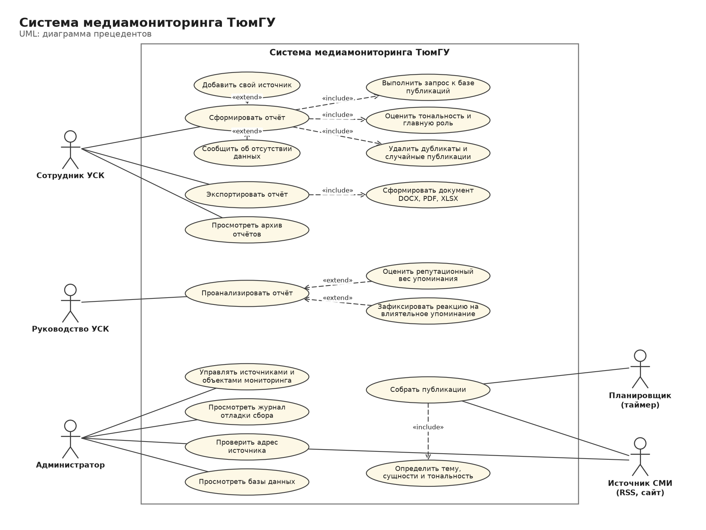
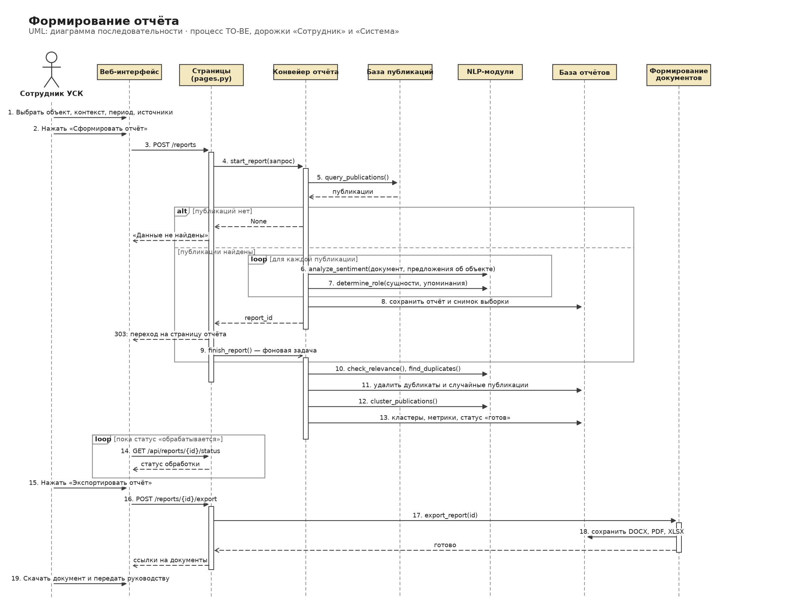
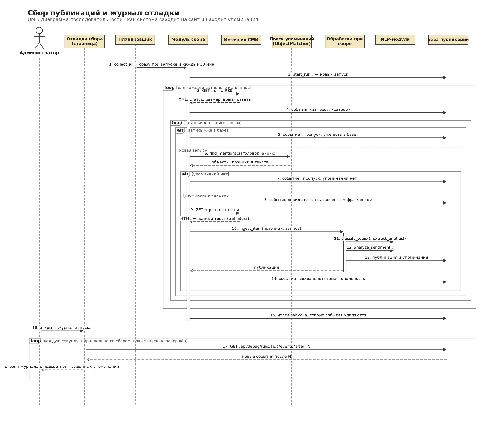
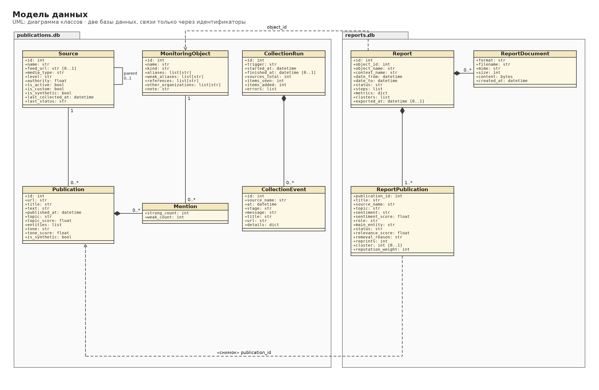
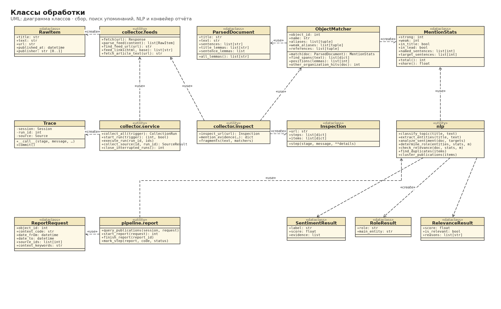
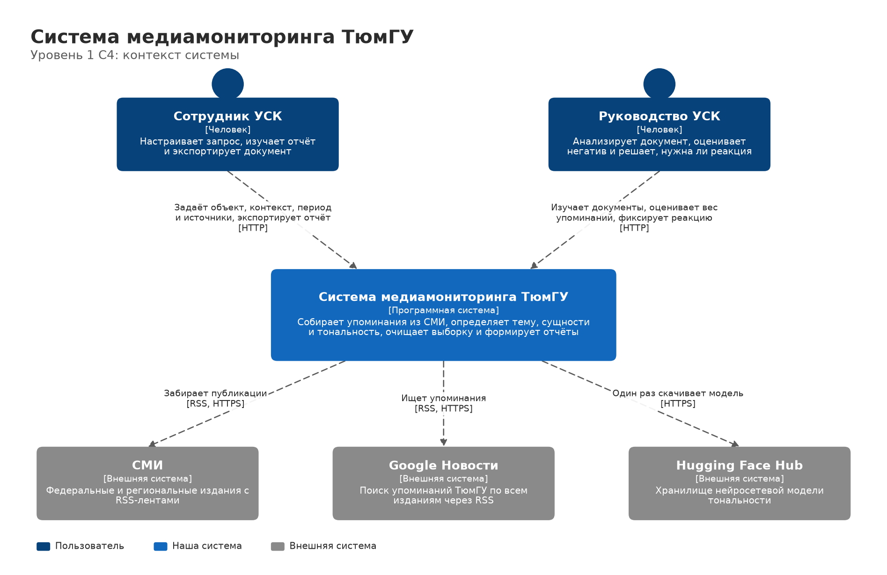
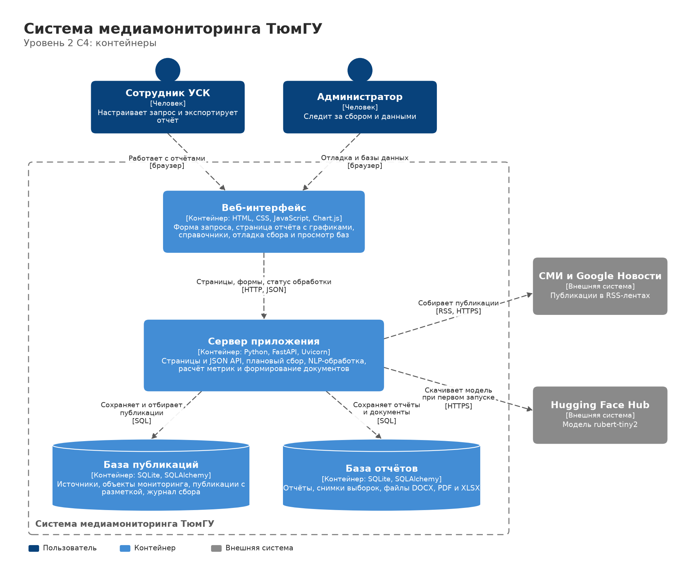
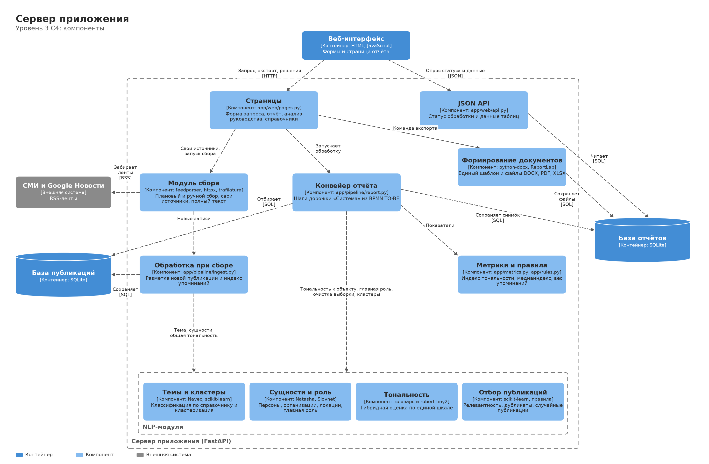

# Медиамониторинг ТюмГУ

Система отслеживает упоминания Тюменского государственного университета в СМИ. Она собирает публикации из реальных источников, определяет тему, извлекает именованные сущности, оценивает тональность, очищает выборку от дубликатов и случайных материалов и формирует отчёт. Отчёт сохраняется в отдельной базе и выгружается в DOCX, PDF и XLSX.

Проект реализует дорожки «Сотрудник» и «Система» процесса TO-BE из BPMN-диаграммы: от настройки запроса до готового документа отчёта. Дорожка «Руководство» выполняется вне системы: руководство работает с выгруженным документом.

## Запуск

Нужен Python 3.12 или новее и интернет.

```bash
python run.py
```

Скрипт создаст виртуальное окружение, установит зависимости и откроет `http://127.0.0.1:8000`. Сразу после старта система собирает публикации из реальных лент и затем повторяет сбор каждые 30 минут. Ход сбора виден на странице «Отладка сбора». Первый запуск занимает несколько минут: скачиваются зависимости и модель тональности (около 120 МБ).

Для демонстрации на тестовых данных:

```bash
python run.py --demo
```

Флаг добавляет 100 синтетических новостей к реальным. Тестовые данные можно загрузить и удалить кнопками на странице «Базы данных».

На Windows окружение создаётся в `%LOCALAPPDATA%\tyumgu-mediamonitoring`, чтобы OneDrive не синхронизировал тысячи служебных файлов.

## Запуск в Docker

Docker упаковывает систему вместе с Python, библиотеками и моделью тональности в один образ. На другом компьютере или сервере не нужно ничего ставить, кроме самого Docker, и система везде запускается одинаково. Удобно для демонстрации на чужом ноутбуке или для развёртывания на сервере.

1. Установите [Docker Desktop](https://www.docker.com/products/docker-desktop/) и запустите его.
2. В папке проекта выполните:

   ```bash
   docker compose up -d --build
   ```

   Первая сборка занимает 5–15 минут: скачиваются Python, библиотеки и модель. Образ весит около 3 ГБ. Повторные запуски проходят за секунды, а с запуском Docker Desktop контейнер стартует сам.
3. Откройте `http://localhost:8000`.

| Действие | Команда |
|---|---|
| Посмотреть журнал работы | `docker compose logs -f` |
| Остановить | `docker compose down` |
| Обновить после `git pull` | `docker compose up -d --build` |
| Удалить вместе с базами | `docker compose down -v` |

Базы лежат в томе Docker `mediamonitoring-data` и сохраняются между перезапусками и пересборками. Тестовые новости включаются строкой `MM_DEMO: "1"` в [docker-compose.yml](docker-compose.yml). По умолчанию система открыта только на том компьютере, где запущена. Чтобы её видели другие в сети, замените в файле порт на `"8000:8000"`, но помните, что авторизации нет.

## Как пройти процесс

1. **Новый отчёт.** Выберите объект, контекст, период и источники, при необходимости добавьте свой сайт или RSS-ленту, нажмите «Сформировать отчёт». Чтобы увидеть ветку «Данные не найдены», укажите период в 2020 году.
2. **Страница отчёта.** Система сама перенаправит на неё, закончит очистку выборки и покажет метрики, графики, кластеры, сущности и таблицу публикаций. На вкладке «Удалённые системой» видно, что и почему убрано.
3. **Экспорт.** Кнопка «Экспортировать отчёт» формирует DOCX, PDF и XLSX и сохраняет их в базе отчётов. Документ передаётся руководству.

## Служебные экраны

- **Отладка сбора.** Журнал каждого запуска в реальном времени: какая лента запрошена, что ответил сервер (статус, размер, время), сколько в ней записей, где найдено упоминание (фрагмент текста с подсветкой названия), удалось ли загрузить полный текст и что сохранено в базу. Кнопка «Запустить сбор» начинает новый запуск и сразу открывает его журнал.
- **Проверить адрес.** Система проходит по любому адресу тем же путём, что и при сборе, и показывает каждый шаг, ничего не записывая в базу. Подходит лента RSS/Atom или обычная страница: со страницы извлекается текст статьи и ищется ссылка на ленту.
- **Базы данных.** Обе базы в режиме просмотра: таблицы, число записей, постраничный просмотр с поиском и полная карточка записи. Здесь же загружаются и удаляются тестовые данные.
- **Объекты мониторинга.** Названия объектов можно редактировать, и они сразу применяются к уже собранным публикациям. Фамилию действующего ректора нужно добавить в объект «Ректор ТюмГУ».

## Соответствие BPMN TO-BE

| Участник | Шаг процесса | Где в системе |
|---|---|---|
| Сотрудник | Выбрать объект, контекст, период, добавить источники | Форма «Новый отчёт» |
| Система | Выполнить запрос, «Данные найдены?» | `query_publications`, сообщение на форме |
| Система | Провести оценку тональности | `app/nlp/sentiment.py` |
| Система | Определить главную роль | `app/nlp/ner.py`, `app/nlp/roles.py` |
| Система | Перенаправить на страницу отчёта | Переход после `start_report` |
| Система | Проверить релевантность, удалить дубликаты и случайные публикации | `finish_report`, `app/nlp/relevance.py`, `app/nlp/dedup.py` |
| Сотрудник | Экспортировать отчёт | Кнопка на странице отчёта |
| Система | Сформировать документ | `app/export` |

Формулы, пороги и веса собраны в [app/rules.py](app/rules.py) и кратко описаны в разделе «Методика» документа отчёта.

Кроме шагов диаграммы, система строит тематические кластеры выборки и считает медиаиндекс: это нужно для отчёта и упомянуто в описании проекта.

## Стек

| Слой | Технологии | Для чего |
|---|---|---|
| Сервер | Python, FastAPI, Uvicorn | Страницы, JSON API, фоновая обработка |
| Интерфейс | Jinja2, HTML, CSS, JavaScript, Chart.js | Работает без сборки фронтенда и без внешних CDN |
| Хранение | SQLite, SQLAlchemy | Две отдельные базы: `publications.db` и `reports.db` |
| Сбор | feedparser, httpx, trafilatura | RSS и Atom, поиск ленты на сайте, полный текст статей |
| Лемматизация | pymorphy3, razdel | Поиск упоминаний во всех падежах |
| Сущности | Natasha, Slovnet | Персоны, организации, локации |
| Тематика | Navec, scikit-learn | Классификация по справочнику без обучения, кластеризация KMeans |
| Тональность | rubert-tiny2 и тональный словарь | Гибридная оценка по шкале от −1 до +1 |
| Документы | python-docx, ReportLab, openpyxl, matplotlib | DOCX, PDF, XLSX с графиками |
| Тесты | pytest | 81 автоматический тест |

## Диаграммы UML

Лежат в [docs/uml](docs/uml), для каждой есть PNG и SVG. Перестроить: `python docs/uml/build_uml.py`.

### Прецеденты



### Последовательность: формирование отчёта



### Последовательность: сбор публикаций и журнал отладки



### Классы: модель данных



### Классы: обработка



## Архитектура в нотации C4

Лежат в [docs/c4](docs/c4). Перестроить: `python docs/c4/build_diagrams.py`.







## Структура проекта

```text
app/
  collector/   сбор из RSS, журнал отладки, проверка адреса, плановый запуск
  nlp/         леммы, сущности, роль, тональность, темы, кластеры, релевантность, дубликаты
  pipeline/    обработка при сборе и конвейер отчёта
  export/      шаблон отчёта и файлы DOCX, PDF, XLSX
  web/         страницы, служебные экраны и JSON API
  templates/   HTML-шаблоны
  static/      стили, скрипты, Chart.js, логотип
  rules.py     единые метрики и правила отбора
  metrics.py   расчёт показателей
data/          синтетические новости и рабочие базы
docs/uml/      диаграммы UML
docs/c4/       диаграммы C4
scripts/       проверка качества на разметке
tests/         автоматические тесты
```

## Базы данных

- **`data/publications.db`:** источники, объекты мониторинга, публикации с разметкой, индекс упоминаний, запуски сбора и журнал отладки. Журнал хранится для последних 20 запусков.
- **`data/reports.db`:** отчёты, снимки выборок с разметкой, файлы документов.

Базы связаны только идентификаторами. Отчёт хранит собственный снимок публикаций, поэтому не меняется при обновлении базы публикаций.

Если приложение остановить посреди сбора, при следующем запуске этот запуск помечается как прерванный и не мешает новым.

## Тестовые данные

[data/synthetic_news.json](data/synthetic_news.json) содержит 100 синтетических новостей за август–октябрь 2026 года с эталонной разметкой.

| Группа | Количество |
|---|---|
| Релевантные публикации | 75 |
| Дубликаты и перепечатки | 12 |
| Случайные: анонсы, другие вузы, ориентиры на местности, биографии, перечисления | 13 |

Все издания, персоны и события вымышлены, а домены `.example` не существуют. Вымышленный ректор Рябинин добавляется в названия объекта только вместе с тестовыми данными и убирается при их удалении. Реальный здесь только сам университет как объект мониторинга, поэтому интерфейс и документы помечают такие данные как тестовые.

## Качество

Проверка на эталонной разметке:

```bash
python -m scripts.evaluate
```

| Задача | Результат на 100 синтетических новостях |
|---|---|
| Релевантность и дубликаты | 100% |
| Роль объекта | 96,0% |
| Тема | 85,3% |
| Тональность | 78,7% |
| Кластеризация | NMI 0,79, ARI 0,59 |

**Эти цифры не показывают качество на реальных СМИ.** Правила и словарь настраивались на этих же 100 текстах. Первый прогон до настройки дал 96% по релевантности, 76% по тональности и 75% по темам. Чтобы получить честную оценку, нужна размеченная людьми выборка реальных публикаций.

## Проверки

Тесты работают на временных базах и без нейросети:

```bash
python -m pytest -q
```

Первый запуск в режиме продакшена с пустой базой: за 28 секунд система обошла 7 лент, просмотрела 566 записей, нашла и сохранила 64 реальные публикации о ТюмГУ из 29 изданий. Отчёт по ним проходит весь процесс до экспорта.

## Настройки

| Переменная | По умолчанию | Значение |
|---|---|---|
| `MM_PORT` | `8000` | Порт сервера |
| `MM_COLLECT_INTERVAL_MINUTES` | `30` | Период автосбора; первый сбор идёт сразу при запуске, `0` отключает автосбор |
| `MM_USE_TRANSFORMER` | `1` | `0` оставляет только тональный словарь |
| `MM_DATA_DIR` | `data/` | Папка с базами |
| `MM_PUBLICATIONS_DB`, `MM_REPORTS_DB` | SQLite в `MM_DATA_DIR` | Адреса баз данных в формате SQLAlchemy |

Если модель тональности недоступна, система продолжит работу на словаре и укажет это в отчёте.

## Ограничения

- Нет авторизации: роли разделены разделами интерфейса, служебные экраны доступны всем, кто открыл систему. Сервер слушает только `127.0.0.1`. Чтобы открыть его в сеть, сначала нужен вход пользователей.
- Сбор работает с RSS-лентами. Сайты без лент, соцсети и закрытые платформы не охватываются. «Проверить адрес» покажет, есть ли у сайта лента.
- Google Новости отдают только заголовок, поэтому такие публикации оцениваются по нему, а не по полному тексту. Из-за этого около трети реальных заголовков попадает в тему «Прочее»: на коротком тексте мало опорных слов. Лента предназначена для личного некоммерческого использования, для промышленной работы нужен лицензированный источник.
- Издания из агрегатора считаются региональными, кроме короткого списка федеральных СМИ в `app/rules.py`.
- Веса медиаиндекса и порог влиятельности — исходные значения, их стоит согласовать с Управлением стратегических коммуникаций.
- Тесты и запуск проверены на Windows и Python 3.14.
